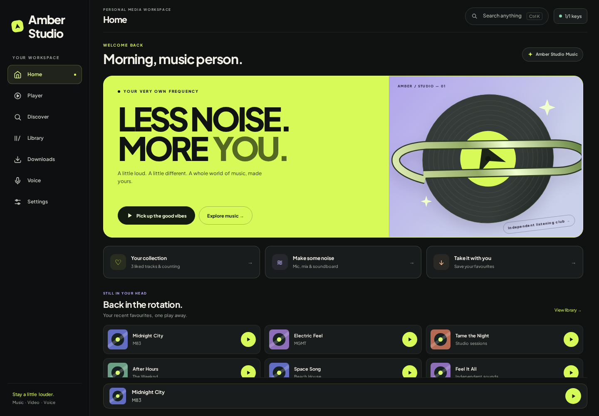

# Amber Studio — Afterhours

A personal listening studio for music, video, voice and soundboards. This repository contains the **Amber Studio** source and its two companion websites.



## What changed

- A completely rebuilt home: acid-yellow editorial hero, original vector record artwork, recent listening, library and voice shortcuts, recommendation filters and refresh.
- Bounded entrance and hover motion, keyboard controls, visible focus, and reduced-motion/performance modes.
- Useful empty and offline states, stale-request protection, working request cancellation, and resume without restarting the current track.
- Autoplay respects its saved off setting. Download pause/resume failures are shown correctly. Local API origin checks reject sandboxed and cross-site callers.
- Embedded third-party TURN credentials removed; deployment-owned relay configuration is supported.

## Download and run

[Download the Studio source ZIP](releases/Amber_Studio_Afterhours_Source.zip). This is source, **not a compiled Windows installer**.

```sh
cd Amber_Studio/01_Amber_Desktop_App
python -m pip install -r requirements.txt
python amber_studio.py
```

On Windows, run `build_exe.bat` from that folder to build `dist/AmberStudioSetup.exe`. The Windows build needs Python, WebView2 and Inno Setup; it has not been built in this Linux workspace. The Studio app identity, port 8878, and independent Studio storage are retained.

- `Amber_Studio/01_Amber_Desktop_App`: desktop source, icon, bundled vendor scripts and installer definitions.
- `Amber_Studio/02_Website_Control`: phone controller; deploy this folder together, including `rtc-config.js`.
- `Amber_Studio/03_Showcase_Website`: the supplied showcase website, retained as an offline demo. Its visuals and screenshots describe the earlier UI.
- `docs/previews`: current UI previews using sample tracks and artwork fixtures.
- `tests`: repeatable browser regressions and real Flask endpoint checks.

The original Amber Classic upload remains unchanged in the workspace; this release focuses on Studio.

## Phone pairing and relay configuration

The desktop and phone controller default to public STUN servers. Some networks require TURN relays. Configure your own `iceServers` configuration on both sides:

- Desktop: set `AMBER_STUDIO_RTC_CONFIG` to a JSON object containing an `iceServers` array before starting Studio.
- Controller: assign the corresponding object to `window.AMBER_RTC_CONFIG` in `02_Website_Control/rtc-config.js` before deploying.

Use deployment-owned, preferably short-lived TURN credentials. Credentials delivered to a browser are visible to that browser's user. Do not commit real credentials to this repository.

## Validation

```sh
python -m pip install -r requirements-dev.txt
python -m playwright install chromium
python -m unittest discover -s tests -v
```

See [the current validation report](docs/VALIDATION.md) for tested behavior and limitations. Chromium uses deterministic API fixtures and synthetic audio for the resume regression; Flask checks use isolated storage. These checks do not establish live YouTube playback, Windows device routing, real WebRTC pairing, OS hotkeys or installer readiness.

The supplied `verification/` and earlier documentation are historical records, not new test runs. Current release notes are in [AFTERHOURS_UPDATE.md](Amber_Studio/AFTERHOURS_UPDATE.md).
